  

  

  
  

---

### 👋 About me

I'm **Nurhalimah**, a Computer Science graduate and aspiring **Software Engineer** who works where software meets data. I build full-stack web applications with **React** and **Python**, design **SQL** databases, and build **ETL pipelines** and **Power BI** dashboards that replace manual, spreadsheet-driven work with reliable digital workflows.

- 🛠️ **Focus:** full-stack web development, data engineering, and digitalization
- 📊 **Recent work:** interactive public-health analytics dashboard for stunting prevalence across Indonesian regencies
- 🌱 **Learning now:** FastAPI, cloud data pipelines, and testing practices for production code
- 🤝 **Open to:** Software Engineer, Full-stack Developer, and Data Engineer roles

---

### 🧰 Tech stack

| Area | Tools |
| :-- | :-- |
| **Frontend** |  |
| **Backend** |  |
| **Data & Databases** |  &nbsp;    |
| **Tools** |  |

---

### 🚀 Featured projects

| Project | What it does | Stack |
| :-- | :-- | :-- |
| [**Stunting Prevalence Dashboard**](https://github.com/halimochy/stunting-prevalence-dashboard) | Interactive map and analytics for stunting prevalence across 500+ Indonesian regencies (2020–2022), with region clustering, KPI cards, and indicator breakdowns for policy targeting. | Python · Streamlit · pandas · Folium · Plotly |
| [**POS Desktop App**](https://github.com/halimochy/pos-desktop-app-java) | Point-of-sale system with login, product catalog from MySQL, cart, payment and change calculation, and transaction history. Team project, 5 members. | Java · Swing · MySQL · JDBC |
| [**Student Records System**](https://github.com/halimochy/student-records-php-mysql) | Web CRUD app for student data with photo upload and one-click PDF report export. | PHP · MySQL · PDO · FPDF · Bootstrap |
| [**Cashier CLI**](https://github.com/halimochy/cashier-cli-java) | Command-line cashier app built around OOP principles: encapsulation, inheritance, and polymorphism. | Java · OOP |

<!-- Add your React, ETL and Power BI projects here as you publish them. Keep 4–6 rows maximum. -->

---

### 📈 GitHub activity

  
  

  

---

### 📫 Let's connect

I'm happy to talk about software engineering roles, data projects, or digitalization ideas.

**LinkedIn:** [linkedin.com/in/halimahnvr](https://www.linkedin.com/in/halimahnvr) · **Email:** [nurhalimahnvr@gmail.com](mailto:nurhalimahnvr@gmail.com)
